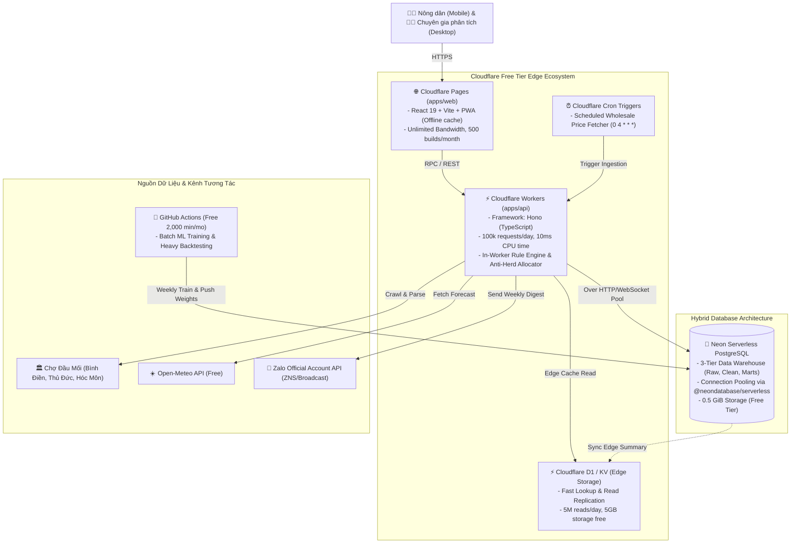

# Architecture & Cloudflare Free Tier Strategy

## 1. Kiến trúc Hệ thống Tổng thể (Cloudflare Edge Topology)

## 2. Kho Dữ Liệu 3 Tầng Trên PostgreSQL
1. **Tầng Thô (`raw_data`)**:
   - Lưu trữ bất biến mọi bản ghi nhận được từ web scraper, API thời tiết hoặc form nhập liệu.
   - Các trường bắt buộc: `id`, `source_id`, `raw_payload` (JSONB), `content_hash` (SHA-256), `fetched_at` (TIMESTAMPTZ).
   - Không bao giờ được phép UPDATE hoặc DELETE trên bảng thô.
2. **Tầng Sạch (`clean_data`)**:
   - Chuẩn hóa mã cây theo từ điển dữ liệu (ví dụ: "cải thìa", "bok choy" -> `crop_code: bok_choy`).
   - Quy đổi toàn bộ đơn vị về `VND/kg`.
   - Lọc ngoại lệ bằng thuật toán Median Absolute Deviation (MAD): Gán cờ `is_outlier = TRUE`, ghi nhận lý do và đưa vào hàng đợi kiểm duyệt thủ công (không tự ý xóa).
   - Nội suy các khoảng trống ngắn trong chuỗi thời gian.
3. **Tầng Tổng Hợp / Phân Tích (`marts`)**:
   - Chuỗi giá tuần, vụ mùa, theo từng vùng/chợ.
   - Các biến phái sinh: Độ trễ giá (lag 1-4 tuần), lượng mưa tích lũy, diện tích gieo hạt vùng, chi phí đầu vào.
   - Sẵn sàng cung cấp trực tiếp cho Edge API và Dashboard phân tích.

## 3. Tối ưu Hóa Chi Phí Miễn Phí (Cloudflare Free Tier Optimization)
- **Zero Cold-Start**: Cloudflare Workers khởi động trong < 5ms, phân tán trên 300+ thành phố toàn cầu.
- **Dung lượng mạng**: Cloudflare Pages hoàn toàn miễn phí băng thông (unlimited bandwidth).
- **CPU Time 10ms Guardrail**: 
  - Các phép tính gợi ý khuyến nghị được đóng gói bằng TypeScript thuần túy (Rule Engine + Anti-Herd), thời gian thực thi chỉ mất 1–2ms.
  - Các phép tính ma trận hoặc mô hình hồi quy nặng được chạy offline trên GitHub Actions (miễn phí 2,000 phút/tháng), sau đó lưu trữ kết quả phân vị (Quantiles) và trọng số vào bảng Marts để Worker chỉ việc đọc.
